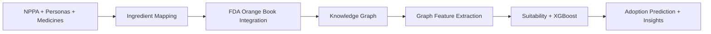

# PharmaDrishti 💊
### AI-Powered Pharmaceutical Market Intelligence Platform

<div align="center">

**Transform pharmaceutical market research from months to minutes**


</div>

---

## 🎯 Executive Summary

PharmaDrishti is a simulation-driven pharmaceutical market intelligence system designed to estimate product adoption probability across heterogeneous demographic and economic segments in India.

The system integrates:

- Large-scale synthetic persona modeling
- Multi-factor adoption scoring
- Regulatory intelligence from FDA Orange Book datasets
- Market intelligence from NPPA dataset
- Knowledge graph feature augmentation
- Gradient-boosted regression (XGBoost)
- SHAP-based feature attribution
- Scenario-based pricing simulation

Predictions are generated in under 5 seconds using a pre-trained model calibrated on large-scale simulated interaction data.

---

## 🚀 Quick Start

```bash
# 1. Install dependencies
pip install -r requirements.txt

# 2. Run dashboard
streamlit run dashboard.py
```

**Dashboard opens at:** `http://localhost:8501`

---

## ✨ Key Features

<table>
<tr>
<td width="50%">

### 🎯 Multi-Factor Analysis
- **Disease Match** (30%)
- **Affordability** (25%)
- **Market Pricing** (20%)
- **Manufacturing** (15%)
- **Risk Tolerance** (10%)

</td>
<td width="50%">

### 🤖 AI-Powered Insights
- Explains WHY scores are what they are
- Identifies specific barriers
- Actionable recommendations
- Expected impact predictions

</td>
</tr>
<tr>
<td width="50%">

### 📊 Interactive Dashboard
- Real-time predictions (< 5 sec)
- Visual analytics & charts
- Scenario comparison
- CSV export for presentations

</td>
<td width="50%">

### 🔬 Robust ML Model
- Baseline + KG-enhanced models
- Leakage-safe feature selection
- Overfitting/leakage diagnostics
- XGBoost algorithm
- Explainable AI (SHAP)

</td>
</tr>
</table>

---

## 💡 How It Works



### 1. Configure Your Medicine
- Target disease
- Batch price (₹5K-₹500K)
- Manufacturing score
- Brand strength
- Side effect risk
- Insurance compatibility under schemes

### 2. AI Analysis
- Analyzes across persona segments
- Builds regulatory-market knowledge graph
- Calculates suitability and graph-augmented predictions

### 3. Get Results
- Overall suitability score
- Best target segments
- Revenue estimates
- AI-powered recommendations

---
## 📊 Data Simulation Framework

The training dataset is generated using a large-scale synthetic interaction engine:

- 10,000 demographic personas
- 5,000 simulated pharmaceutical products
- 50,000,000 persona–medicine interactions

Each interaction encodes:

- Disease relevance
- Price-to-income ratio
- Insurance coverage compatibility
- Manufacturing accessibility
- Brand strength
- Risk tolerance alignment

The resulting dataset is used to train a supervised regression model to predict adoption suitability score.

### Regulatory + Knowledge Graph Layer

PharmaDrishti integrates:

- `nppaipdms.csv` (market data)
- `standardized_data/products_standardized.csv`
- `standardized_data/patents_standardized.csv`
- `standardized_data/exclusivity_standardized.csv`
- `standardized_data/reference_standardized.csv`

Knowledge graph nodes include Drug, Ingredient, Manufacturer, Patent, and Exclusivity entities. Graph-derived features (e.g., competitor count and protection horizon) are appended to training data for the KG-enhanced model.

---

## 🧪 Training & Diagnostics Workflow

### 1) Baseline model training

```bash
python train_model.py
```

### 2) KG-enhanced training (expanded personas + full medicines)

```bash
python - <<'PY'
from kg_enhanced_training import run_pipeline
run_pipeline(
    base_dir='.',
    persona_target_count=1000,
    persona_file='indian_healthcare_personas_expanded.json',
    n_personas=None,
    n_medicines=5000,
    outlier_method='iqr',
    outlier_strategy='flag',
)
PY
```

### 3) Overfitting / leakage diagnostics

```bash
python overfitting_diagnostics.py --mode baseline --base-dir . --model-path models/adoption_model.pkl --persona-file indian_healthcare_personas_expanded.json --n-personas 1000 --n-medicines 1000
python overfitting_diagnostics.py --mode kg_enhanced --base-dir . --model-path models/adoption_model_kg_enhanced.pkl --persona-file indian_healthcare_personas_expanded.json --n-personas 1000 --n-medicines 1000
```

Diagnostics include train/test gap, 5-fold CV, learning curves, target-shuffle leakage test, feature correlations, SHAP importance, and residual analysis.

---

## 🖼️ Research Outputs

Generated in `outputs/`:

- `graph_summary_metrics.png` (Table 1-ready summary)
- `table2_ablation_study.png`
- `table3_dataset_overview.png`
- `plot4_degree_distribution.png`
- `plot6_model_performance_comparison.png`
- `research_paper_sections.txt`
- `diagnostics/baseline/overfitting_diagnostic_report.json`
- `diagnostics/kg_enhanced/overfitting_diagnostic_report.json`

---


### ROI Example
**Mid-Size Pharma Company** (5 products/year)
- Traditional Cost: ₹5Cr
- PharmaDrishti: ₹25L
- **Annual Savings: ₹4.75Cr**
- **ROI: 1,900%**

---

## 🎓 Use Cases

### 1. Batch Pricing Optimization
Test multiple price points to maximize revenue vs adoption

**Example:**
- ₹30K: 82% adoption, ₹24.6Cr revenue
- ₹80K: 51% adoption, ₹40.8Cr revenue
- **Recommendation:** Tiered pricing by city tier

### 2. Manufacturing Assessment
Evaluate manufacturing capability for target markets

**Example:**
- Tier 1: 68% adoption (high manufacturing access)
- Tier 3: 23% adoption (manufacturing barrier)
- **Recommendation:** Partner with local manufacturers

### 3. Market Segmentation
Identify optimal target demographics for phased launch

**Example:**
- Tier 1, High Income: 85% adoption
- Tier 2, Middle Income: 62% adoption
- **Recommendation:** Start Tier 1, expand after 6 months

---

**Model Performance (Synthetic Validation):**
- R² Score: > 0.85
- Training Time: 15–30 minutes
- Memory Requirement: 8–16GB RAM
- Model Size: ~50–100 MB

---

## 📊 Dashboard Guide

### Input Parameters

| Parameter                   | Range     | Description                  |
| --------------------------- | --------- | ---------------------------- |
| **Target Disease**          | Dropdown  | Disease medicine treats      |
| **Batch Price**             | ₹5K-₹500K | Medicine batch price         |
| **Launch Locality**         | Dropdown  | State or Pan-India           |
| **Brand Strength**          | 0.0-1.0   | Generic to Premium           |
| **Side Effect Risk**        | 0.0-1.0   | Safe to High Risk            |
| **Manufacturing Score**     | 0.0-1.0   | Limited to High Capability   |
| **Insurance under Schemes** | 0.0-1.0   | Not Covered to Fully Covered |

### Score Interpretation

| Score Range | Interpretation                      |
| ----------- | ----------------------------------- |
| 70–100      | High predicted adoption suitability |
| 40–70       | Moderate suitability                |
| 0–40        | Low suitability                     |

---

### Core Modules

1. Persona Generator – Constructs demographic and economic distributions
2. Interaction Engine – Simulates adoption score per persona-product pair
3. Regulatory Loader – Ingests NPPA + Orange Book datasets
4. Knowledge Graph Builder – Creates regulatory-market graph
5. Graph Feature Extractor – Derives competition/protection features
6. Model Trainer – Trains baseline and KG-enhanced XGBoost regressors
7. Diagnostics Engine – Overfitting and leakage checks
8. Prediction Engine – Real-time inference

```
┌─────────────────────────────────────┐
│      Streamlit Dashboard            │
│                                     │
└──────────────┬──────────────────────┘
               │
               ▼
┌─────────────────────────────────────┐
│  Persona Manager | Prediction Engine│
│  Insights Generator (Gemini AI)     │
└──────────────┬──────────────────────┘
               │
               ▼
┌─────────────────────────────────────┐
│  10K Personas | XGBoost Model       │
│  50M Interactions                   │
└─────────────────────────────────────┘
```

### Technology Stack
- **Frontend:** Streamlit 
- **ML:** XGBoost, SHAP
- **AI:** Google Gemini
- **Data:** Pandas, NumPy
- **Viz:** Plotly

---

## 📚 Documentation

| Document                                | Description                  |
| --------------------------------------- | ---------------------------- |
| **README.md**                           | This file - overview         |
| **DASHBOARD_SETUP.md**                  | Detailed setup guide         |
| **FEATURES.md**                         | Complete feature docs        |
| **QUICK_REFERENCE.md**                  | Quick reference card         |
| **METRICS_AND_FORMULAS.md**             | Scoring metrics and formulas |
| **outputs/research_paper_sections.txt** | Paper-ready section draft    |

---

## 🎯 System Metrics

| Metric                 | Value                      |
| ---------------------- | -------------------------- |
| Personas               | 10,000                     |
| Simulated Interactions | 50,000,000                 |
| Diseases Modeled       | 10                         |
| Model Type             | XGBoost Regressor          |
| Validation R²          | > 0.85 (synthetic dataset) |
| Training Time          | 15–30 minutes              |
| Prediction Latency     | < 5 seconds                |
| Model Size             | ~50–100 MB                 |
| Geographic Modeling    | 10 states, 25+ cities      |

---

## 🔧 Troubleshooting

### Dashboard Won't Start
```bash
pip install -r requirements.txt
streamlit run dashboard.py --server.port 8502
```

### AI Insights Missing
- Configure Gemini API key
- Check internet connection
- Verify key at [Google AI Studio](https://makersuite.google.com/app/apikey)

### Model Training Fails
- Ensure 16GB+ RAM
- Check disk space (5GB+)
- Reduce dataset size temporarily

---

## 🗺️ Roadmap

### ✅ Phase 1: MVP (Completed)
- [x] 10,000 diverse personas
- [x] 50M interaction dataset
- [x] XGBoost prediction model
- [x] Interactive dashboard
- [x] AI-powered insights

### 📅 Phase 2: Q1 2026
- [ ] 20,000+ personas
- [ ] 20+ disease categories
- [ ] NPPA pricing integration
- [ ] Competitive analysis
- [ ] Mobile responsive design

### 📅 Phase 3: Q2 2026
- [ ] Pilot with pharma companies
- [ ] Real launch validation
- [ ] Case studies
- [ ] API access

### 📅 Phase 4: Q3-Q4 2026
- [ ] SaaS platform
- [ ] Enterprise features
- [ ] Mobile app
- [ ] Multi-language support


---

## ⚠️ Limitations

- Current implementation relies on synthetic data simulation
- Does not model physician prescription behavior
- Regulatory coverage depends on source data completeness and mapping quality
- No real-world post-launch validation integrated yet
- Economic and insurance parameters are modeled assumptions

---


