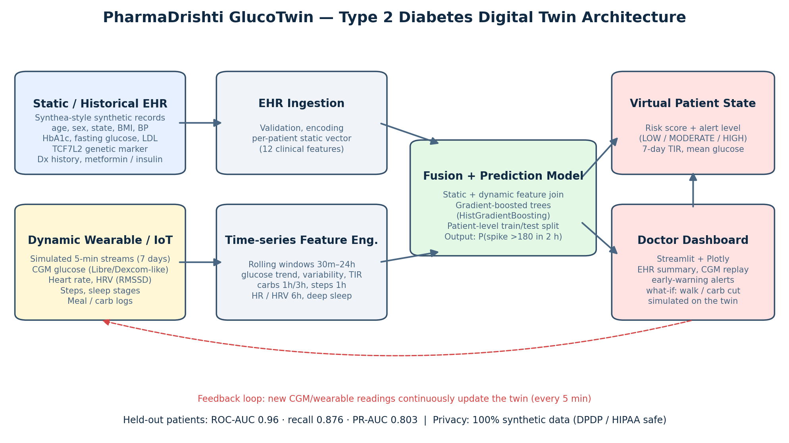
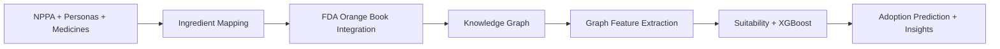

# PharmaDrishti GlucoTwin 💊🩸
### A Type 2 Diabetes Digital Twin — fusing EHR + wearable data to predict glucose spikes 2 hours ahead

<div align="center">

**Digital Twin Challenge 2026 (Happiest Health) — Prototype & Code Submission**

📽️ [Demo Video](#-demo-video) · 🏗️ [Architecture Diagram (PDF)](docs/Architecture_Diagram.pdf) · 📑 [Presentation (PDF)](docs/PharmaDrishti_Presentation.pdf) · ⚖️ [MIT License](LICENSE) · 🧪 [Prototype code](digital_twin/)

</div>

---

## 📌 Submission Checklist

| Item | Where |
| --- | --- |
| Team details | [Team Details](#-team-details) |
| College / Incubator information | [College / Incubator](#-college--incubator-information) |
| Project title | [Project Title](#-project-title) |
| Problem statement | [Problem Statement](#-problem-statement) |
| Healthcare use case | [Healthcare Use Case](#-healthcare-use-case) |
| Technical stack | [Technical Stack](#-technical-stack) |
| AI/ML model & framework details | [AI/ML Model Details](#-aiml-model--framework-details) |
| Demo video (Unlisted YouTube) | [Demo Video](#-demo-video) |
| Open-source license | [License](#-open-source-license) · [LICENSE](LICENSE) |
| Architecture diagram (PDF) | [docs/Architecture_Diagram.pdf](docs/Architecture_Diagram.pdf) |
| Presentation (PDF) | [docs/PharmaDrishti_Presentation.pdf](docs/PharmaDrishti_Presentation.pdf) |
| Public accessibility | Public repository; all files are committed here; the video is Unlisted (opens from the link, no sign-in needed) |

---

## 👥 Team Details

**Team Name:** PharmaDrishti

| Name | Role | Email | GitHub |
| --- | --- | --- | --- |
| Somya Upadhyay | Team Lead — ML & Data Engineering | `<email>` | [@Somyaaaaa23](https://github.com/Somyaaaaa23) |
| `<Member 2>` | `<Role>` | `<email>` | `<github>` |
| `<Member 3>` | `<Role>` | `<email>` | `<github>` |

---

## 🏫 College / Incubator Information

- **College / Institution:** `<College name>`
- **Department / Program:** `<Department>`
- **City, State:** `<City, State>`
- **Incubator (if any):** `<Incubator name / Not applicable>`

---

## 🏷️ Project Title

**PharmaDrishti GlucoTwin — A Type 2 Diabetes Digital Twin for 2-Hour-Ahead Hyperglycaemia Prediction**

---

## ❗ Problem Statement

- India has an estimated **101 million people with diabetes** and **136 million with prediabetes** (ICMR-INDIAB, 2023). Type 2 Diabetes is the chosen condition.
- Diabetes care is **reactive**: patients see a doctor every few months, and HbA1c reflects the past 3 months, not what is happening now.
- Repeated **post-meal glucose spikes (>180 mg/dL)** drive long-term heart, kidney, eye and nerve complications.
- CGMs and smartwatches produce continuous data, but no clinical tool **fuses it with the patient's EHR** to warn the doctor **before** an adverse event.

---

## 🏥 Healthcare Use Case

**GlucoTwin** creates a virtual replica of each T2D patient that combines:

1. **Static / historical EHR:** demographics, Indian state, BMI, BP, HbA1c, fasting glucose, LDL, **TCF7L2 genetic risk marker**, family history, T2D / hypertension diagnoses, metformin / insulin.
2. **Dynamic wearable / IoT streams (every 5 min):** CGM glucose, heart rate, HRV (RMSSD), steps, sleep stages, meal carb logs.

**Adverse event predicted:** a hyperglycaemic spike (**CGM > 180 mg/dL within the next 2 hours**) while the patient is currently in range.

**How a doctor uses it** (`digital_twin/doctor_dashboard.py`):
- Pick a virtual patient → see the EHR summary next to live CGM, HR/HRV, steps and meals
- Get a **2-hour spike risk score** and alert level (LOW / MODERATE / HIGH) with suggested action
- **Replay** the past 7 days to see when and why alerts fire
- **What-if simulation on the twin:** add a walk or cut carbs and see the predicted risk change before advising the patient
- Weekly summary: time-in-range, time above 180, mean glucose, average steps

---

## 🧰 Technical Stack

| Layer | Technology |
| --- | --- |
| Language | Python 3.10+ |
| Data generation / processing | NumPy, Pandas |
| ML model | scikit-learn `HistGradientBoostingClassifier`, joblib |
| Doctor dashboard | Streamlit, Plotly |
| Docs / diagrams | Matplotlib |
| Extended PharmaDrishti modules | XGBoost, SHAP, NetworkX knowledge graph (NPPA + FDA Orange Book) for therapy affordability and access |

---

## 🤖 AI/ML Model & Framework Details

**Data (100% synthetic, no real patient data; DPDP Act / HIPAA safe):**
- `generate_ehr()`: 200 Synthea-style Indian patient records; HbA1c depends on BMI, age, TCF7L2 alleles and family history.
- `simulate_wearables()`: 7 days per patient at 5-min resolution. Glucose is simulated from meal absorption × insulin resistance (from HbA1c, BMI and medication), minus activity, plus dawn phenomenon, poor-sleep stress and sensor noise. HR and HRV are linked to activity, sleep and glucose.

**Fusion features (at every 5-min step):**
- 14 wearable features: current glucose, 30/60-min trend, 3-h mean/std, 24-h max, 24-h time-in-range, carbs last 1 h / 3 h, steps last 1 h, HR 1 h, HRV 6 h, deep sleep, hour of day
- 12 EHR features joined per patient

**Model:** gradient-boosted decision trees (`HistGradientBoostingClassifier`, 300 iterations, class-balanced).
**Validation:** patient-level split. 20% of virtual patients are never seen in training, which tests generalisation to new twins.

**Results on held-out patients** (`digital_twin/models/metrics.json`):

| Metric | Value |
| --- | --- |
| ROC-AUC (EHR + wearable fusion) | **0.96** |
| PR-AUC | 0.803 |
| Recall / Precision / F1 (threshold 0.5) | 0.876 / 0.586 / 0.702 |
| Ablation: wearable-only ROC-AUC | 0.957 |
| Ablation: EHR-only ROC-AUC | 0.935 |
| Labelled windows (train / test) | 262,062 / 70,100 |
| Spike base rate | 13.6% |

Fusing both streams gives the best result. Note that these numbers come from simulated physiology; validation on real open datasets (OhioT1DM, MIMIC-IV) is the next step.

### ▶️ Run the prototype

```bash
pip install -r requirements.txt
python digital_twin/twin.py                       # generate synthetic EHR + wearables, train, evaluate (~15 s)
streamlit run digital_twin/doctor_dashboard.py    # doctor dashboard at http://localhost:8501
python digital_twin/make_docs.py                  # regenerate architecture + presentation PDFs
```

---

## 📽️ Demo Video

▶️ **Demo video, at least 20 minutes (Unlisted YouTube):** `<PASTE YOUTUBE LINK HERE>`

---

## 🏗️ Architecture Diagram

📄 **PDF:** [docs/Architecture_Diagram.pdf](docs/Architecture_Diagram.pdf)



---

## 📑 Presentation

📄 **PDF:** [docs/PharmaDrishti_Presentation.pdf](docs/PharmaDrishti_Presentation.pdf): problem, healthcare use case, data streams, architecture, AI/ML model, outcomes & results, tech stack, limitations and roadmap.

---

## ⚖️ Open-source License

This project is released under the **MIT License**; see [LICENSE](LICENSE). All patient data in this repository is synthetic. Public datasets used by the extended modules (NPPA, FDA Orange Book) remain subject to their original terms.

---

## ➕ Extended Module: PharmaDrishti Market & Access Intelligence

The repository also contains the original PharmaDrishti engine. It is a population-level simulation of 10,000 Indian healthcare personas that estimates whether patients can afford and access a therapy. On the roadmap, it will recommend affordable treatment options for the patient segments that GlucoTwin flags as high-risk.

### Executive Summary

PharmaDrishti is a simulation-driven pharmaceutical market intelligence system designed to estimate product adoption probability across heterogeneous demographic and economic segments in India.

The system integrates:

- Large-scale synthetic persona modeling
- Multi-factor adoption scoring
- Regulatory intelligence from FDA Orange Book datasets
- Market intelligence from NPPA dataset
- Knowledge graph feature augmentation
- Gradient-boosted regression (XGBoost)
- SHAP-based feature attribution
- Scenario-based pricing simulation

Predictions are generated in under 5 seconds using a pre-trained model calibrated on large-scale simulated interaction data.

---

## 🚀 Quick Start

```bash
# 1. Install dependencies
pip install -r requirements.txt

# 2. Run dashboard
streamlit run dashboard.py
```

**Dashboard opens at:** `http://localhost:8501`

---

## ✨ Key Features

<table>
<tr>
<td width="50%">

### 🎯 Multi-Factor Analysis
- **Disease Match** (30%)
- **Affordability** (25%)
- **Market Pricing** (20%)
- **Manufacturing** (15%)
- **Risk Tolerance** (10%)

</td>
<td width="50%">

### 🤖 AI-Powered Insights
- Explains WHY scores are what they are
- Identifies specific barriers
- Actionable recommendations
- Expected impact predictions

</td>
</tr>
<tr>
<td width="50%">

### 📊 Interactive Dashboard
- Real-time predictions (< 5 sec)
- Visual analytics & charts
- Scenario comparison
- CSV export for presentations

</td>
<td width="50%">

### 🔬 Robust ML Model
- Baseline + KG-enhanced models
- Leakage-safe feature selection
- Overfitting/leakage diagnostics
- XGBoost algorithm
- Explainable AI (SHAP)

</td>
</tr>
</table>

---

## 💡 How It Works



### 1. Configure Your Medicine
- Target disease
- Batch price (₹5K-₹500K)
- Manufacturing score
- Brand strength
- Side effect risk
- Insurance compatibility under schemes

### 2. AI Analysis
- Analyzes across persona segments
- Builds regulatory-market knowledge graph
- Calculates suitability and graph-augmented predictions

### 3. Get Results
- Overall suitability score
- Best target segments
- Revenue estimates
- AI-powered recommendations

---
## 📊 Data Simulation Framework

The training dataset is generated using a large-scale synthetic interaction engine:

- 10,000 demographic personas
- 5,000 simulated pharmaceutical products
- 50,000,000 persona–medicine interactions

Each interaction encodes:

- Disease relevance
- Price-to-income ratio
- Insurance coverage compatibility
- Manufacturing accessibility
- Brand strength
- Risk tolerance alignment

The resulting dataset is used to train a supervised regression model to predict adoption suitability score.

### Regulatory + Knowledge Graph Layer

PharmaDrishti integrates:

- `nppaipdms.csv` (market data)
- `standardized_data/products_standardized.csv`
- `standardized_data/patents_standardized.csv`
- `standardized_data/exclusivity_standardized.csv`
- `standardized_data/reference_standardized.csv`

Knowledge graph nodes include Drug, Ingredient, Manufacturer, Patent, and Exclusivity entities. Graph-derived features (e.g., competitor count and protection horizon) are appended to training data for the KG-enhanced model.

---

## 🧪 Training & Diagnostics Workflow

### 1) Baseline model training

```bash
python train_model.py
```

### 2) KG-enhanced training (expanded personas + full medicines)

```bash
python - <<'PY'
from kg_enhanced_training import run_pipeline
run_pipeline(
    base_dir='.',
    persona_target_count=1000,
    persona_file='indian_healthcare_personas_expanded.json',
    n_personas=None,
    n_medicines=5000,
    outlier_method='iqr',
    outlier_strategy='flag',
)
PY
```

### 3) Overfitting / leakage diagnostics

```bash
python overfitting_diagnostics.py --mode baseline --base-dir . --model-path models/adoption_model.pkl --persona-file indian_healthcare_personas_expanded.json --n-personas 1000 --n-medicines 1000
python overfitting_diagnostics.py --mode kg_enhanced --base-dir . --model-path models/adoption_model_kg_enhanced.pkl --persona-file indian_healthcare_personas_expanded.json --n-personas 1000 --n-medicines 1000
```

Diagnostics include train/test gap, 5-fold CV, learning curves, target-shuffle leakage test, feature correlations, SHAP importance, and residual analysis.

---

## 🖼️ Research Outputs

Generated in `outputs/`:

- `graph_summary_metrics.png` (Table 1-ready summary)
- `table2_ablation_study.png`
- `table3_dataset_overview.png`
- `plot4_degree_distribution.png`
- `plot6_model_performance_comparison.png`
- `research_paper_sections.txt`
- `diagnostics/baseline/overfitting_diagnostic_report.json`
- `diagnostics/kg_enhanced/overfitting_diagnostic_report.json`

---


### ROI Example
**Mid-Size Pharma Company** (5 products/year)
- Traditional Cost: ₹5Cr
- PharmaDrishti: ₹25L
- **Annual Savings: ₹4.75Cr**
- **ROI: 1,900%**

---

## 🎓 Use Cases

### 1. Batch Pricing Optimization
Test multiple price points to maximize revenue vs adoption

**Example:**
- ₹30K: 82% adoption, ₹24.6Cr revenue
- ₹80K: 51% adoption, ₹40.8Cr revenue
- **Recommendation:** Tiered pricing by city tier

### 2. Manufacturing Assessment
Evaluate manufacturing capability for target markets

**Example:**
- Tier 1: 68% adoption (high manufacturing access)
- Tier 3: 23% adoption (manufacturing barrier)
- **Recommendation:** Partner with local manufacturers

### 3. Market Segmentation
Identify optimal target demographics for phased launch

**Example:**
- Tier 1, High Income: 85% adoption
- Tier 2, Middle Income: 62% adoption
- **Recommendation:** Start Tier 1, expand after 6 months

---

**Model Performance (Synthetic Validation):**
- R² Score: > 0.85
- Training Time: 15–30 minutes
- Memory Requirement: 8–16GB RAM
- Model Size: ~50–100 MB

---

## 📊 Dashboard Guide

### Input Parameters

| Parameter                   | Range     | Description                  |
| --------------------------- | --------- | ---------------------------- |
| **Target Disease**          | Dropdown  | Disease medicine treats      |
| **Batch Price**             | ₹5K-₹500K | Medicine batch price         |
| **Launch Locality**         | Dropdown  | State or Pan-India           |
| **Brand Strength**          | 0.0-1.0   | Generic to Premium           |
| **Side Effect Risk**        | 0.0-1.0   | Safe to High Risk            |
| **Manufacturing Score**     | 0.0-1.0   | Limited to High Capability   |
| **Insurance under Schemes** | 0.0-1.0   | Not Covered to Fully Covered |

### Score Interpretation

| Score Range | Interpretation                      |
| ----------- | ----------------------------------- |
| 70–100      | High predicted adoption suitability |
| 40–70       | Moderate suitability                |
| 0–40        | Low suitability                     |

---

### Core Modules

1. Persona Generator – Constructs demographic and economic distributions
2. Interaction Engine – Simulates adoption score per persona-product pair
3. Regulatory Loader – Ingests NPPA + Orange Book datasets
4. Knowledge Graph Builder – Creates regulatory-market graph
5. Graph Feature Extractor – Derives competition/protection features
6. Model Trainer – Trains baseline and KG-enhanced XGBoost regressors
7. Diagnostics Engine – Overfitting and leakage checks
8. Prediction Engine – Real-time inference

```
┌─────────────────────────────────────┐
│      Streamlit Dashboard            │
│                                     │
└──────────────┬──────────────────────┘
               │
               ▼
┌─────────────────────────────────────┐
│  Persona Manager | Prediction Engine│
│  Insights Generator (Gemini AI)     │
└──────────────┬──────────────────────┘
               │
               ▼
┌─────────────────────────────────────┐
│  10K Personas | XGBoost Model       │
│  50M Interactions                   │
└─────────────────────────────────────┘
```

### Technology Stack
- **Frontend:** Streamlit 
- **ML:** XGBoost, SHAP
- **AI:** Google Gemini
- **Data:** Pandas, NumPy
- **Viz:** Plotly

---

## 📚 Documentation

| Document                                | Description                  |
| --------------------------------------- | ---------------------------- |
| **README.md**                           | This file - overview         |
| **DASHBOARD_SETUP.md**                  | Detailed setup guide         |
| **FEATURES.md**                         | Complete feature docs        |
| **QUICK_REFERENCE.md**                  | Quick reference card         |
| **METRICS_AND_FORMULAS.md**             | Scoring metrics and formulas |
| **outputs/research_paper_sections.txt** | Paper-ready section draft    |

---

## 🎯 System Metrics

| Metric                 | Value                      |
| ---------------------- | -------------------------- |
| Personas               | 10,000                     |
| Simulated Interactions | 50,000,000                 |
| Diseases Modeled       | 10                         |
| Model Type             | XGBoost Regressor          |
| Validation R²          | > 0.85 (synthetic dataset) |
| Training Time          | 15–30 minutes              |
| Prediction Latency     | < 5 seconds                |
| Model Size             | ~50–100 MB                 |
| Geographic Modeling    | 10 states, 25+ cities      |

---

## 🔧 Troubleshooting

### Dashboard Won't Start
```bash
pip install -r requirements.txt
streamlit run dashboard.py --server.port 8502
```

### AI Insights Missing
- Configure Gemini API key
- Check internet connection
- Verify key at [Google AI Studio](https://makersuite.google.com/app/apikey)

### Model Training Fails
- Ensure 16GB+ RAM
- Check disk space (5GB+)
- Reduce dataset size temporarily

---

## 🗺️ Roadmap

### ✅ Phase 1: MVP (Completed)
- [x] 10,000 diverse personas
- [x] 50M interaction dataset
- [x] XGBoost prediction model
- [x] Interactive dashboard
- [x] AI-powered insights

### 📅 Phase 2: Q1 2026
- [ ] 20,000+ personas
- [ ] 20+ disease categories
- [ ] NPPA pricing integration
- [ ] Competitive analysis
- [ ] Mobile responsive design

### 📅 Phase 3: Q2 2026
- [ ] Pilot with pharma companies
- [ ] Real launch validation
- [ ] Case studies
- [ ] API access

### 📅 Phase 4: Q3-Q4 2026
- [ ] SaaS platform
- [ ] Enterprise features
- [ ] Mobile app
- [ ] Multi-language support


---

## ⚠️ Limitations

- Current implementation relies on synthetic data simulation
- Does not model physician prescription behavior
- Regulatory coverage depends on source data completeness and mapping quality
- No real-world post-launch validation integrated yet
- Economic and insurance parameters are modeled assumptions

---


